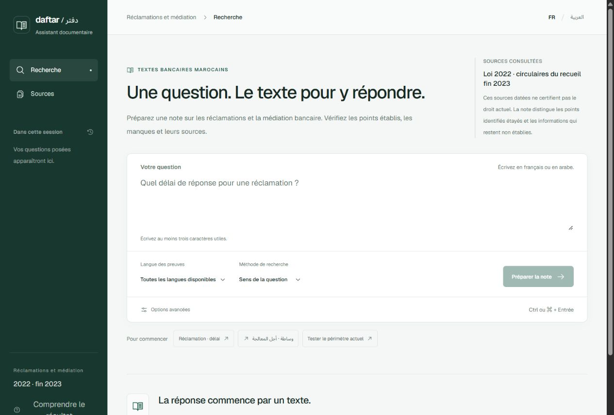
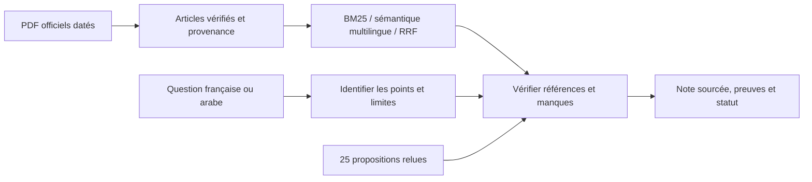

# Daftar / دفتر — assistant documentaire bancaire marocain

[](https://github.com/moussoulijane/rag-reglementation-maroc/actions/workflows/ci.yml)

**Poser une question en français ou en arabe. Préparer une note sourcée. Voir les points établis et les informations manquantes.**

[English](README.md) · [Guide V3 étape par étape](docs/GUIDE_ASSISTANT_V3.md) · [Implémentation et validation](reports/assistant-v3/IMPLEMENTATION.md) · [Sources](docs/SOURCES.md)



Daftar est un assistant documentaire local consacré aux **réclamations et à la médiation bancaire au Maroc**, développé avec Python, FastAPI, React et TypeScript. Il associe une recherche multilingue à un catalogue explicite de 25 propositions relues en interne. Chaque note expose les points identifiés, les articles, les éditions datées et les manques. La génération libre est désactivée dans ce profil.

**Prototype de recherche.** Le corpus est daté ; l’applicabilité actuelle, la revue professionnelle indépendante et le pilote utilisateur restent à valider. Les notes arabes sont des résumés du projet, pas des traductions officielles des circulaires françaises.

## Fonctionnalités

- Cinq décisions : points identifiés étayés, réponse partielle, information non établie, date non couverte ou précision nécessaire.
- Preuves avec document, édition, article, page PDF et empreinte SHA-256.
- Trace distinguant les candidats de la recherche et l’expansion des références guidée par le catalogue.
- Questions FR/AR, interface arabe de droite à gauche, filtres de langue des preuves, contexte d’établissement et date juridique explicite.
- Export Markdown avec statut, manques et références ; les extraits bruts des PDF restent hors de l’export.

Exemple : **« Quel délai de réponse à une réclamation et quel montant d’indemnisation ? »**. Le comportement attendu est une note partielle : établir le point documenté et laisser le montant manquant visible. Une demande de délai ambiguë ou de règle actuellement applicable permet d’observer la clarification et la limite temporelle.

## Corpus et architecture

| Source datée | Langues | Enregistrements d’articles |
| --- | --- | ---: |
| Loi 103-12, édition du 31 mars 2022 | Français et arabe | 394 : 197 par langue |
| Circulaire 9/W/2016, recueil BAM fin 2023 | Français | 9 |
| Circulaire 10/W/2016, même recueil | Français | 15 |
| **Total** | **221 FR + 197 AR** | **418** |

Les deux circulaires proviennent du même PDF de recueil. Leur rédaction ou leur numérotation diffère des scans individuels ; ces versions restent séparées. Voir les [sources](docs/SOURCES.md) et la [discussion des versions](reports/assistant-v3/IMPLEMENTATION.md#corpus-et-versions).



La référence gelée reste dans `rag_reglementation_maroc` ; la couche V3 délimitée est dans `rag_reglementation_assistant`. L’interface React appelle `/assistant/ask`. L’ancienne API `/ask` et ses évaluations restent disponibles. L’adaptateur Ollama expérimental et le backend OpenSearch optionnel appartiennent à la référence antérieure ; ils ne valident pas une génération V3.

## Lancer le projet

Python **3.11 ou 3.12**, Node **24**. Dans PowerShell, depuis un nouveau clone :

```powershell
git clone https://github.com/moussoulijane/rag-reglementation-maroc.git
Set-Location rag-reglementation-maroc
py -3.11 -m venv .venv
.\.venv\Scripts\python.exe -m pip install -e ".[dev]"

# Télécharger les PDF officiels datés, vérifier et extraire les articles retenus.
.\.venv\Scripts\rag-maroc.exe download
.\.venv\Scripts\rag-maroc.exe ingest
.\.venv\Scripts\rag-maroc-assistant.exe prepare-domain

# Compiler l’interface et démarrer en BM25, sans poids de modèle ni API payante.
npm --prefix frontend ci
npm --prefix frontend run build
$env:RAG_ENCODER = 'none'
.\.venv\Scripts\rag-maroc-ui.exe --host 127.0.0.1 --port 8000
```

Ouvrir [Daftar en local](http://127.0.0.1:8000/). Pour le classement sémantique multilingue, installer et préparer l’encodeur optionnel, puis relancer le service :

```powershell
.\.venv\Scripts\python.exe -m pip install -e ".[dev,neural]"
.\.venv\Scripts\rag-maroc.exe prepare-model
$env:RAG_ENCODER = 'multilingual'
.\.venv\Scripts\rag-maroc-ui.exe --host 127.0.0.1 --port 8000
```

La préparation du modèle est explicite ; le service ne télécharge aucun poids au démarrage. La révision de l’encodeur et les empreintes documentaires sont fixées. Le [guide V3](docs/GUIDE_ASSISTANT_V3.md) détaille les requêtes CLI, les filtres, les notes et les évaluations. Le [guide de déploiement](docs/DEPLOYMENT.md) décrit l’ancienne API, Docker et les adaptateurs optionnels.

## Ce que démontre l’évaluation

**Diagnostic de développement V3 :** 35 situations déclinées en français/arabe, utilisées pendant l’implémentation. Le [lot final](reports/assistant-v3/development-final-verified/RESULTATS.md) correspond aux annotations internes sur **70/70 variantes**, avec **0/26 réponses faussement complètes** parmi les cas attendus non complets. Les contrôles mécaniques des citations réussissent. Le [premier lot et ses erreurs](reports/assistant-v3/development-bm25-01/RESULTATS.md) restent publics.

Ces exemples connus sont corrélés. Ils vérifient le contrat du catalogue ; **ils ne signifient pas une exactitude juridique de 100 % ni une fidélité générale des réponses**. Le modèle de test réservé est vide ; la revue juridique indépendante et le pilote métier restent à réaliser. [Contrôles et travail restant](reports/assistant-v3/IMPLEMENTATION.md).

Le **challenge de recherche V2** montre pourquoi la suffisance d’une réponse doit être évaluée séparément. Sur 20 nouveaux thèmes internes, déclinés dans quatre directions linguistiques :

| Méthode | Rappel d’article à 5 | MRR@5 | Cas sans réponse refusés |
| --- | ---: | ---: | ---: |
| BM25 | 21/48 (43,8 %) | 0,378 | 26/32 |
| Sémantique | 43/48 (89,6 %) | 0,732 | 20/32 |
| Hybride | 42/48 (87,5 %) | 0,740 | 17/32 |

Le mode sémantique a accepté 12/32 cas sans réponse ; l’hybride, 15/32. **Trouver un article apparenté ne prouve pas qu’il répond à la question.** [Résultats](reports/challenge-v2/RESULTATS.md) · [Analyse des erreurs](reports/challenge-v2/ERREURS.md) · [Protocole et gel](docs/CHALLENGE_V2.md).

Les périmètres et corpus V2/V3 diffèrent : il ne s’agit pas d’une comparaison causale avant/après. Aucune des deux évaluations n’est une expertise juridique externe.

## Vérification et parcours pédagogique

Contrôles locaux V3 : **188 tests Python réussis**, Ruff et build frontend réussis, neuf parcours HTTP réels réussis, interface embarquée servie par la roue installée. [Logiciel](reports/assistant-v3/software_and_integrity_checks.json) · [HTTP](reports/assistant-v3/http-smoke.json) · [Distribution](reports/assistant-v3/distribution_checks.json). La CI vérifie Python 3.11/3.12, les tests/build frontend et la construction Docker sans télécharger corpus ni modèle. L’exécution du conteneur V3 n’a pas été validée localement.

```powershell
.\.venv\Scripts\python.exe -m pytest -q
.\.venv\Scripts\python.exe -m ruff check .
.\.venv\Scripts\python.exe -m ruff format --check .
npm --prefix frontend run test:note
npm --prefix frontend run build
```

Commencer par le [guide en dix séances](docs/GUIDE_PAS_A_PAS.md), suivre une question dans le [code V3](docs/GUIDE_ASSISTANT_V3.md#4-suivre-une-question-dans-le-code), puis reproduire l’[atelier d’évaluation](docs/ATELIER_EVALUATION_V2.md). Le [plan d’amélioration](docs/PLAN_ASSISTANT_REGLEMENTAIRE.md) définit le futur test indépendant et le pilote.

## Données et licences

Le code est sous [MIT](LICENSE). Les PDF BAM, textes extraits, index, embeddings et poids de modèle restent exclus de Git sous `data/` ; les réponses brutes de revue restent sous `outputs/`, également ignoré. Les commandes téléchargent les documents depuis leurs sources officielles. Documents, modèles, polices et bibliothèques tiers conservent leurs droits et licences. L’environnement est consigné dans [requirements.lock](requirements.lock) ; une installation neuve à partir de ce seul verrou reste non validée.
