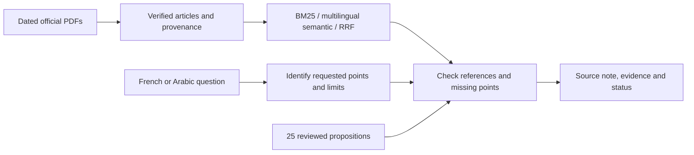

# Daftar / دفتر — Moroccan banking regulation assistant

[](https://github.com/moussoulijane/rag-reglementation-maroc/actions/workflows/ci.yml)

**Ask in French or Arabic. Prepare a source note. See what the documents establish and what is still missing.**

[Français](README.fr.md) · [Step-by-step V3 guide](docs/GUIDE_ASSISTANT_V3.md) · [Implementation and validation](reports/assistant-v3/IMPLEMENTATION.md) · [Sources](docs/SOURCES.md)


Daftar is a local documentary assistant for **banking complaints and mediation in Morocco**, built with Python, FastAPI, React and TypeScript. It combines multilingual retrieval with an explicit catalogue of 25 internally reviewed propositions. Each note exposes its identified points, article references, dated editions and missing information. Free-form generation is disabled in this profile.

**Research prototype.** The corpus is dated; current legal applicability, independent professional review and a user pilot remain unvalidated. The Arabic notes are project-authored summaries, not official translations of the French circulars.

## What it does

- Returns five decisions: supported identified points, partial answer, information not established, date not covered, or clarification needed.
- Preserves document, edition, article, PDF page and SHA-256 provenance with the evidence.
- Separates retrieval candidates from catalogue-guided reference expansion in its trace.
- Supports French/Arabic questions, Arabic RTL layout, source-language filters, institution context and an explicit legal date.
- Exports a Markdown note with status, gaps and references; raw PDF extracts stay out of the export.

For example, ask **“Quel délai de réponse à une réclamation et quel montant d’indemnisation ?”**. The intended behavior is a partial note: establish the documented point and keep the missing amount visible. Ask an ambiguous deadline question or request the currently applicable rule to inspect clarification and temporal limits.

## Corpus and architecture

| Dated source | Languages | Article records |
| --- | --- | ---: |
| Law 103-12, edition of 31 March 2022 | French and Arabic | 394: 197 per language |
| Circular 9/W/2016, BAM collection at end-2023 | French | 9 |
| Circular 10/W/2016, same collection | French | 15 |
| **Total** | **221 FR + 197 AR** | **418** |

The two circulars come from one collection PDF. Their wording/numbering differs from standalone scans; these versions are kept separate. See the [source record](docs/SOURCES.md) and [version discussion](reports/assistant-v3/IMPLEMENTATION.md#corpus-et-versions).



The frozen retrieval baseline lives in `rag_reglementation_maroc`; the bounded V3 layer lives in `rag_reglementation_assistant`. The React interface calls `/assistant/ask`. The original `/ask` API and its evaluation records remain available. An experimental Ollama adapter and optional OpenSearch backend belong to the earlier baseline; they do not validate V3 generation.

## Run locally

Python **3.11 or 3.12**, Node **24**. PowerShell, from a new clone:

```powershell
git clone https://github.com/moussoulijane/rag-reglementation-maroc.git
Set-Location rag-reglementation-maroc
py -3.11 -m venv .venv
.\.venv\Scripts\python.exe -m pip install -e ".[dev]"

# Download the dated official PDFs and verify/extract the selected articles.
.\.venv\Scripts\rag-maroc.exe download
.\.venv\Scripts\rag-maroc.exe ingest
.\.venv\Scripts\rag-maroc-assistant.exe prepare-domain

# Build the interface and start with BM25; no model weights or paid API needed.
npm --prefix frontend ci
npm --prefix frontend run build
$env:RAG_ENCODER = 'none'
.\.venv\Scripts\rag-maroc-ui.exe --host 127.0.0.1 --port 8000
```

Open [Daftar locally](http://127.0.0.1:8000/). For multilingual semantic ranking, install and prepare the optional encoder, then restart the service:

```powershell
.\.venv\Scripts\python.exe -m pip install -e ".[dev,neural]"
.\.venv\Scripts\rag-maroc.exe prepare-model
$env:RAG_ENCODER = 'multilingual'
.\.venv\Scripts\rag-maroc-ui.exe --host 127.0.0.1 --port 8000
```

Model preparation is explicit; service startup never downloads weights. The encoder revision and document fingerprints are pinned. The [V3 guide](docs/GUIDE_ASSISTANT_V3.md) explains CLI queries, filters, source notes and evaluation commands. The [deployment guide](docs/DEPLOYMENT.md) covers the earlier API, Docker and optional adapters.

## What the evaluation establishes

**V3 development diagnostic:** 35 situations translated into French/Arabic, used during implementation. The [final run](reports/assistant-v3/development-final-verified/RESULTATS.md) matches the internal status annotation on **70/70 variants**, with **0/26 false complete answers** among cases expected to be incomplete. Mechanical citation checks pass. The [first run and its errors](reports/assistant-v3/development-bm25-01/RESULTATS.md) remain public.

These are correlated, known development cases. They check the catalogue's contract; **they do not mean 100% legal accuracy or general answer faithfulness**. The reserved test template is empty, and independent legal review and a real user pilot remain pending. [Validation details and remaining work](reports/assistant-v3/IMPLEMENTATION.md).

The earlier **V2 retrieval challenge** shows why answer sufficiency needs a separate check. On 20 new internal topics, translated into four language directions:

| Method | Article Recall@5 | MRR@5 | Unsupported cases refused |
| --- | ---: | ---: | ---: |
| BM25 | 21/48 (43.8%) | 0.378 | 26/32 |
| Semantic | 43/48 (89.6%) | 0.732 | 20/32 |
| Hybrid | 42/48 (87.5%) | 0.740 | 17/32 |

Semantic retrieval accepted 12/32 unsupported cases; hybrid accepted 15/32. **Finding a related article does not establish that it answers the question.** [Results](reports/challenge-v2/RESULTATS.md) · [Error analysis](reports/challenge-v2/ERREURS.md) · [Protocol and freeze](docs/CHALLENGE_V2.md).

V2 and V3 use different scopes and corpora, so these results are not a causal before/after comparison. Neither evaluation is an external legal assessment.

## Verification and learning path

Local V3 checks: **188 Python tests passed**, Ruff and frontend build passed, nine real HTTP scenarios passed, and the installed wheel served its bundled UI. [Software](reports/assistant-v3/software_and_integrity_checks.json) · [HTTP](reports/assistant-v3/http-smoke.json) · [Distribution](reports/assistant-v3/distribution_checks.json). CI checks Python 3.11/3.12, frontend tests/build and Docker image construction without downloading the corpus or model. V3 container runtime behavior has not been validated locally.

```powershell
.\.venv\Scripts\python.exe -m pytest -q
.\.venv\Scripts\python.exe -m ruff check .
.\.venv\Scripts\python.exe -m ruff format --check .
npm --prefix frontend run test:note
npm --prefix frontend run build
```

Start with the [ten-session learning guide](docs/GUIDE_PAS_A_PAS.md), follow a question through the [V3 code walkthrough](docs/GUIDE_ASSISTANT_V3.md#4-suivre-une-question-dans-le-code), then reproduce the [evaluation workshop](docs/ATELIER_EVALUATION_V2.md). The [improvement plan](docs/PLAN_ASSISTANT_REGLEMENTAIRE.md) defines the future independent test and pilot.

## Data and licensing

Code is under [MIT](LICENSE). BAM PDFs, extracted text, indexes, embeddings and model weights are excluded from Git under `data/`; raw review responses stay under ignored `outputs/`. Download commands retrieve documents from their official sources. Third-party documents, models, fonts and libraries retain their own rights and licenses. The environment lock is recorded in [requirements.lock](requirements.lock); a fresh lock-only installation remains unvalidated.
