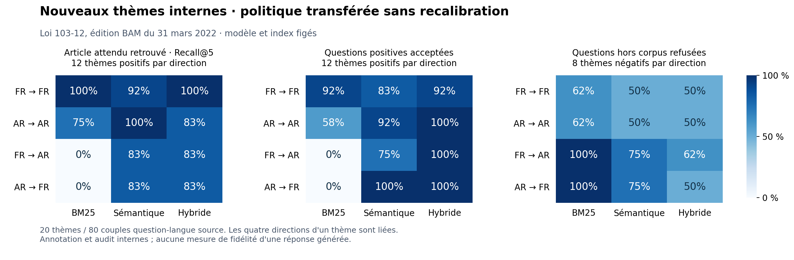

# Bilan de l'étape du 18 octobre 2026

La recherche bilingue a maintenant été mesurée sur de **nouveaux thèmes**, avec les réglages conservés. Le moteur sémantique retrouve l'article attendu dans 43 des 48 couples positifs. Le principal point faible est la décision d'abstention : une forte proximité avec un sujet ne garantit pas que le texte donne la réponse précise.

La génération locale produit désormais deux réponses avec citations exactes sur des cas de développement connus. Les refus restants et la couverture partielle d'une consultation restent visibles. Cela établit un fonctionnement ciblé, sans valider la fidélité générale d'un assistant juridique.

## Nouveaux thèmes, avant de regarder les scores

Le challenge comporte **20 thèmes** : 12 répondables et huit hors corpus. Chaque thème est décliné dans les quatre directions FR→FR, AR→AR, FR→AR et AR→FR, soit 80 couples question/langue-source, dont 48 positifs et 32 négatifs. Ces variantes ne sont pas indépendantes.

Les questions ont été rédigées à partir des sources locales, sans consulter leur classement. Un second agent a relu les annotations, les deux langues et le périmètre des négatifs. Trois clarifications linguistiques ont été corrigées avant le gel. L'audit est interne, sans adjudication juridique externe.

- [Protocole et critères fixés](../../docs/CHALLENGE_V2.md).
- [Nouvelles questions originales](../../evaluation/challenge_v2.json).
- [Audit des annotations](../../evaluation/challenge_v2_audit.json).
- [Manifeste figé avant exécution](../../evaluation/challenge_v2_manifest.json).
- [Résultats complets](../challenge-v2/RESULTATS.md) et [analyse des erreurs](../challenge-v2/ERREURS.md).

Le manifeste a été créé le 18 octobre à 22:24:23 UTC, avant la première recherche sur ce lot. Il fixe questions, protocole, audit, politique et 16 fichiers Python. La CLI vérifie aussi l'empreinte exacte du moteur, les modes calibrés et la disjonction avec le benchmark d'origine. Elle refuse un dossier de résultats déjà rempli.

Les seuils restent ceux du développement initial : lexical 0,25, sémantique 0,65, hybride 0,60. Aucune calibration sur ces nouvelles questions ni modification du classement à partir de leurs résultats n'a été effectuée.

## Ce que montrent les résultats

| Mode | Recall@5 sur positifs | MRR@5 | Positifs acceptés | Négatifs refusés |
| --- | ---: | ---: | ---: | ---: |
| BM25 | 21/48 — 43,8 % | 0,378 | 18/48 — 37,5 % | 26/32 — 81,3 % |
| Sémantique | 43/48 — 89,6 % | 0,732 | 42/48 — 87,5 % | 20/32 — 62,5 % |
| Hybride | 42/48 — 87,5 % | 0,740 | 47/48 — 97,9 % | 17/32 — 53,1 % |

Les deux moteurs neuronaux retrouvent l'article attendu pour 10 des 12 thèmes dans chaque direction croisée. BM25 ne retrouve aucun de ces articles dans les directions croisées sur ce lot. Il constitue une baseline monolingue utile ; son bon taux de refus global inclut ces nombreuses questions qu'il ne peut traiter.

L'hybride n'est pas uniformément meilleur. Sa MRR est légèrement supérieure, mais son rappel global est inférieur au sémantique et il accepte davantage de négatifs. Quasi-toutes les questions positives sont acceptées en hybride, y compris six couples dont l'article annoté manque au top cinq.

Les cas manqués concernent notamment la protection des fonds des comptes de paiement en liquidation, certaines formes juridiques et une notification de sanction. Une lecture de l'article retrouvé est nécessaire pour distinguer proximité du thème et preuve de la règle.

Le filtre accepte encore des questions sur un délai horaire d'incident cyber, un gabarit technique de plan de redressement, un montant chiffré de garantie ou un contrat d'API absent du corpus. L'article qui délègue la fixation d'un plafond peut être très proche de la question sans contenir le chiffre demandé. Ce comportement explique pourquoi le cosinus ne peut pas servir de vérificateur de réponse.

Les scores historiques de 55 % puis 85 % de rappel hybride restent conservés. Ils portent sur d'autres thèmes ; leur comparaison avec 87,5 % ne mesure pas causalement une amélioration du modèle. Le nouveau lot demeure une petite évaluation interne, sur la même loi datée de 2022.

## Génération locale : causes et correction limitée

Le délai à froid du 17 octobre avait interrompu le chargement de Qwen avant sa fin. Un préchargement distinct a supprimé cette erreur opérationnelle sur le nouveau lot. Le modèle et ses poids n'ont pas changé.

Un [lot V2 fixé](../generation-v2/RESULTATS.md) a toutefois montré des abstentions persistantes, même avec le passage présent. Des [contrôles synthétiques de développement](../generation-development-controls/protocol.json) ont ensuite comparé les formats sur un fait inventé : placer les affirmations avant la décision d'abstention dans le schéma a permis une réponse que l'ordre inverse ne produisait pas. Ce contraste ne prouve pas une fidélité générale.

Le correctif du client conserve les mêmes clés, consignes et règles de cohérence. Seul l'ordre des champs du schéma change. Les seuils et les règles de refus avant génération restent identiques.

Le [lot V3](../generation-v3/RESULTATS.md) reprend une fois les mêmes six cas déjà vus, avec protocole distinct :

- un cas ciblé français et une consultation arabe produisent chacun une affirmation avec citation exacte ;
- trois autres cas sont refusés par Qwen ;
- un cas arabe est refusé par le filtre lexical avant tout appel au modèle.

La [première revue](../generation-v3/manual_review_primary.json) et la [seconde revue interne](../generation-v3/second_review.json) jugent les deux affirmations soutenues. La consultation arabe ne couvre toutefois pas tout l'article : support d'une affirmation et couverture d'une demande restent distincts. Aucun taux agrégé de fidélité n'est revendiqué. Les textes et citations nécessaires aux revues restent dans les sorties locales ignorées.

Le refus français sur l'agrément est conservé lorsque l'article utile manque aux résultats. Le refus arabe sur ce même sujet persiste malgré la présence d'un passage pertinent. Le schéma corrigé n'a pas résolu tous les refus injustifiés.

## Contrôles logiciels et reproduction

**147 tests réussis**, aucun ignoré, avec les tests d'inférence réelle activés ; un avertissement de dépréciation Starlette/httpx. Le [contrôle d'intégrité et logiciel](software_and_integrity_checks.json) conserve les effectifs et vérifie les ressources gelées inchangées. Ruff, format et dépendances sont vérifiés. Le [wheel de cette étape](packaging_smoke.json) s'importe après installation et conserve les seize sources gelées. Les validations Docker et OpenSearch du [bilan du 17 octobre](../VALIDATION.md) restent des preuves historiques ; aucune nouvelle validation de ces conteneurs n'est attribuée à cette étape.

Les commandes exactes de gel et d'évaluation figurent dans le protocole. La relance avec le même manifeste exige des fichiers figés inchangés et un nouveau dossier de sortie. Une correction motivée par ces erreurs rendrait la prochaine mesure sur ce même lot exploratoire.

Pour comprendre et reproduire le raisonnement, commence par l'[atelier d'évaluation V2](../../docs/ATELIER_EVALUATION_V2.md), puis le [guide pas à pas](../../docs/GUIDE_PAS_A_PAS.md). Le [déploiement](../../docs/DEPLOYMENT.md) décrit le préchargement explicite avant une session Ollama ; aucun téléchargement n'a lieu au lancement de l'API.

## Priorité suivante

La prochaine amélioration doit porter sur la suffisance des preuves : le texte fournit-il le montant, le délai, la procédure ou l'autorité précisément demandés ? Il faudra comparer les faux positifs évités aux questions valides nouvellement refusées, sur des données de développement séparées puis de nouveaux thèmes encore inédits.

À ce stade, le projet démontre une recherche bilingue mesurée et des échecs analysés de façon reproductible. L'usage comme assistant juridique fiable n'est pas établi.

Les règles Git préservent aussi les octets des fichiers gelés malgré les réglages CRLF/LF : 24 chemins de ressources et de rapports ont été vérifiés avec les filtres Git sous `core.autocrlf=true` et `false`. Cette précaution conserve les empreintes à l'enregistrement dans Git ; elle ne remplace pas un essai complet d'installation sur une autre machine.
