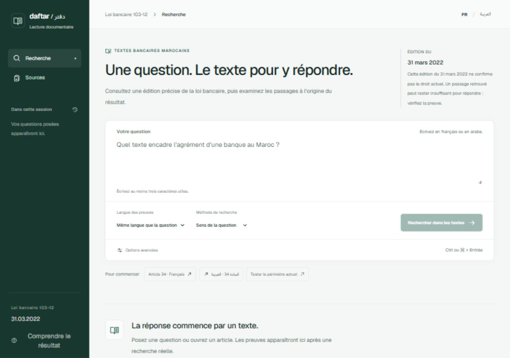

# Validation de l’interface Daftar

Date : 19 octobre 2026. Interface locale du projet RAG de réglementation bancaire marocaine.

## Résultat

L’interface React est reliée au moteur réel par FastAPI. Les recherches, citations et refus observés ci-dessous proviennent du corpus local, sans réponses de démonstration.

## Parcours vérifiés dans le navigateur

| Contrôle | Résultat observé |
| --- | --- |
| Exemple français « article 34 » | 5 passages français, tous rattachés à l’article 34. |
| Exemple arabe « المادة 34 » | 4 passages arabes ; interface avec lang=ar et direction RTL. |
| Citation française | Édition du 31 mars 2022, pages de l’article 24–25, lien PDF officiel avec #page=24. |
| Citation arabe | Lien vers le PDF arabe officiel avec #page=24. |
| Question arabe, sources françaises | Consultation du même article avec le filtre Français : 5 passages français. |
| Langue de l’interface | Le changement FR/AR conserve la langue des preuves déjà obtenues. |
| Question affichée avec le résultat | Reste celle soumise même après modification du formulaire. |
| Question sur la réglementation actuellement en vigueur | Refus expliqué : l’édition de 2022 ne confirme pas le droit actuel ; aucune citation affichée. |
| Chargement | État d’attente visible pendant une recherche réelle. |
| Sources | Deux PDF officiels ; 197 articles et 84 pages chacun ; empreintes SHA-256 et liens de provenance. |
| Copie d’empreinte | Le bouton français affiche « Copié » après activation. |
| Historique | Restaure un résultat réel dans la session ; effacement vérifié. Historique perdu au rechargement. |
| Aide | Dialogue ouvert ; fermeture par Échap vérifiée. |
| Options avancées | Extraits sélectionnés par défaut ; reformulation présentée comme expérimentale et disponibilité non vérifiée. |
| Classement | Chargé à la demande ; degré de classement explicitement distinct d’une probabilité de vérité. |
| Ordinateur | Affichage vérifié à 1280 × 900. |
| Mobile FR et AR | Affichage vérifié à 390 × 844 ; largeur du document 375 px, aucun débordement horizontal. |
| Menu mobile | Dialogue identifié ; fermeture automatique lors du retour à 1280 px. |
| Console | Aucun message d’erreur recueilli pour le parcours principal. |
| Corpus absent | Second serveur local temporaire : message explicite, recherche désactivée même après sélection d’un exemple ; nombre d’articles « Non chargé ». Serveur de test arrêté. |

Un premier exemple, formulé comme une question de fond autour de l’article 34, était refusé par le seuil existant. Les deux exemples sont devenus des consultations directes (« article 34 » / « المادة 34 »). Aucun seuil, moteur ou jeu d’évaluation n’a été modifié.

## Vérifications logicielles

- Suite Python complète avec les tests du modèle activés : **156 tests réussis**, un avertissement de dépréciation Starlette/httpx.
- Ruff : contrôle et formatage réussis ; 42 fichiers déjà formatés.
- TypeScript et build de production Vite réussis.
- Bundle final : `index-Cpj33U0S.js` ; feuille de style : `index-DQovFNdH.css`.
- `docker compose config --quiet` réussi.
- Installation éditable avec le backend de build déclaré ; commande `rag-maroc-ui --help` vérifiée.
- Roue installée dans un répertoire séparé avec les dépendances du venv existant, puis vraie commande console lancée sur un port de test : page et **19 fichiers statiques** servis avec les bons types et les mêmes empreintes ; aucun ancien bundle dans la roue.
- Sans corpus : page 200, readiness 503 et asset inconnu 404 dans la distribution installée.
- **16 sources Python et 5 ressources gelées** identiques au manifeste, dans le dépôt et dans la roue. Le premier projet est resté propre.
- Données, réponses brutes, modèles, environnements et node_modules restent exclus de Git.

Empreinte de la roue testée : `03861f6e5ab2de3f4442322096ee4967b78aa98c86039f34d302dd9e7d3e5d5e`.
Preuve technique locale complète : `outputs/ui-package/smoke.json` (ignorée par Git).

## Limites de cette validation

La validation du logiciel ne démontre pas l’exactitude de toute réponse. Le corpus reste l’édition du 31 mars 2022 ; les pages citées sont celles de l’article, pas nécessairement celles du passage précis.

La reformulation Ollama n’a pas été testée dans ce parcours UI. Les états HTTP 422/503 en cours de recherche n’ont pas été provoqués dans le navigateur ; les contrats API et l’état initial sans corpus ont été vérifiés. Aucun audit complet d’accessibilité ou essai de zoom à 200 % n’est revendiqué.

L’image Docker de cette interface n’a pas été exécutée : daemon Docker indisponible. Le Dockerfile et la configuration Compose sont préparés.

La capture publique contient uniquement l’accueil, sans extraits des documents BAM. Le serveur principal reste limité à 127.0.0.1.

## Reproduire et comprendre

Suivre [le guide de l’interface](../../docs/INTERFACE.md), puis [le guide pas à pas](../../docs/GUIDE_PAS_A_PAS.md). L’évaluation scientifique reste documentée dans [le bilan v2](../extension-v2/BILAN.md).
